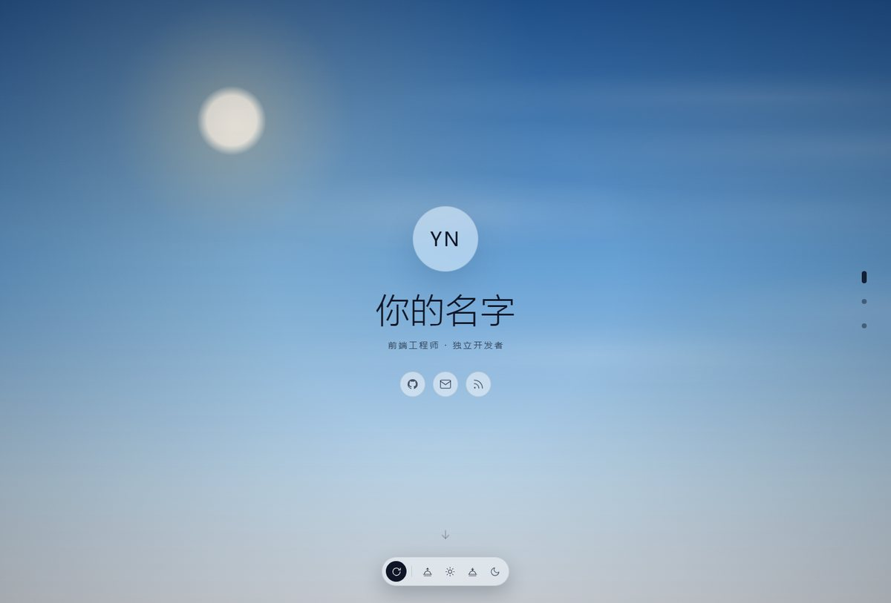
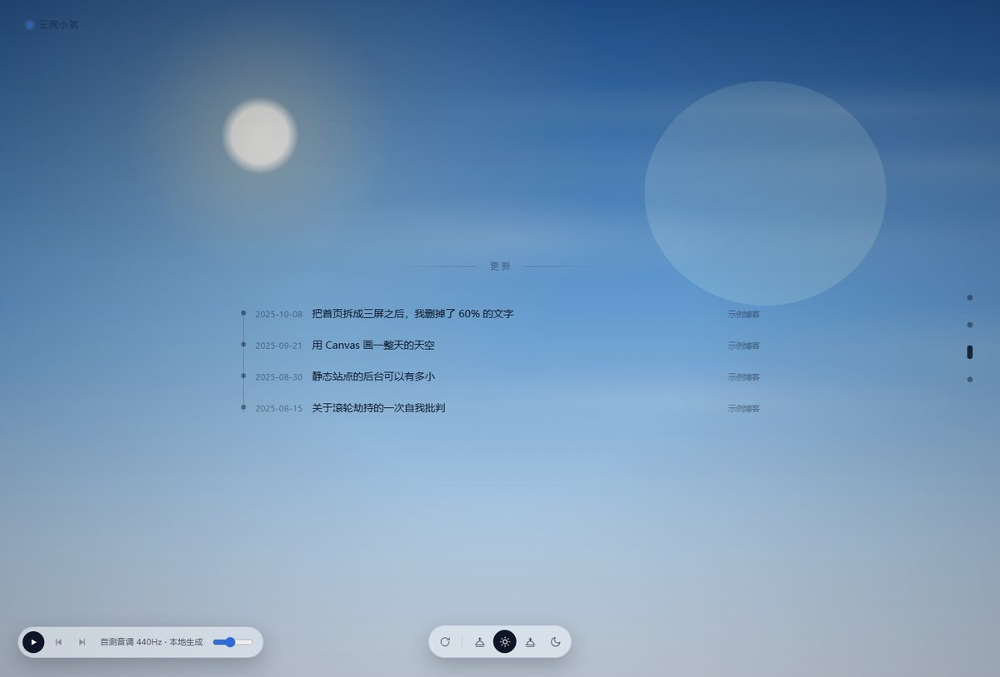
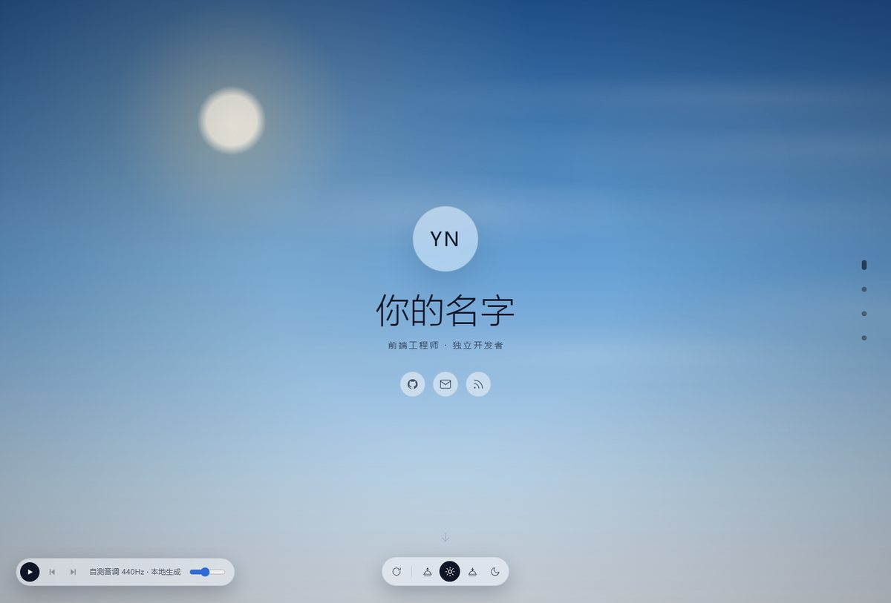
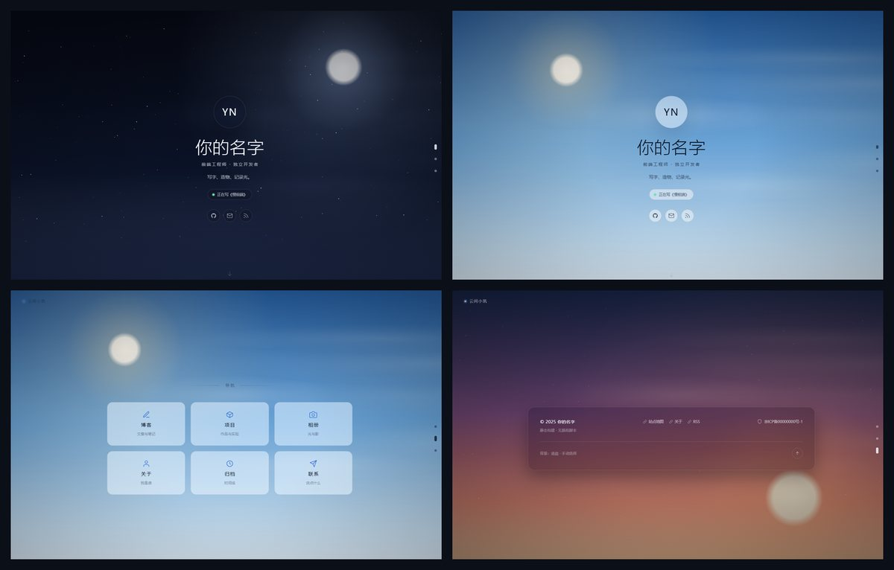
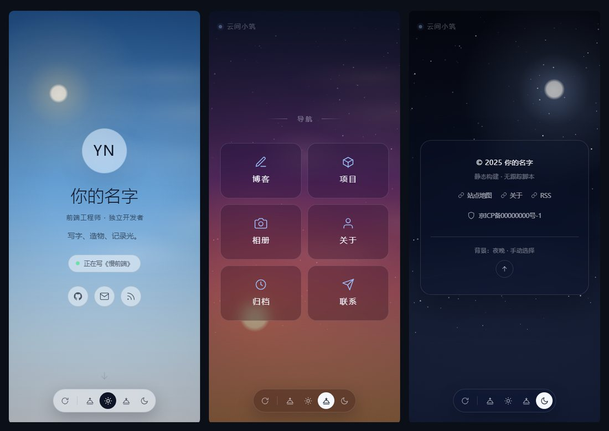
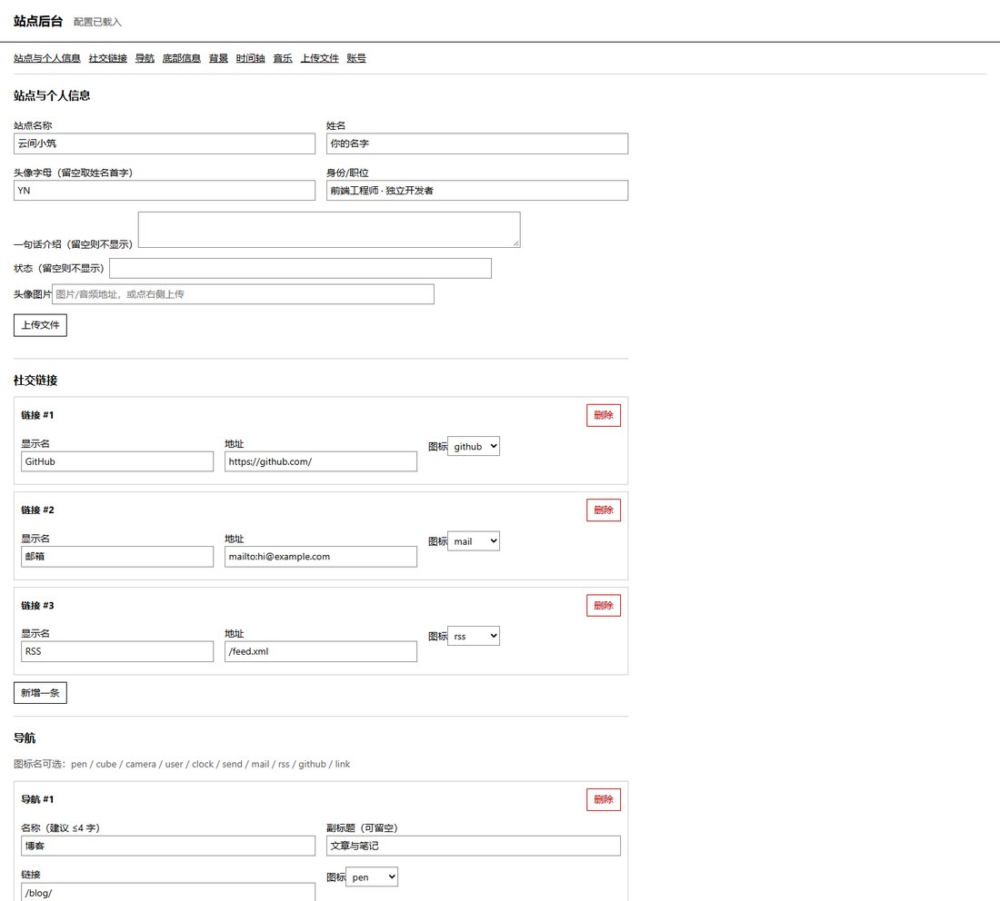
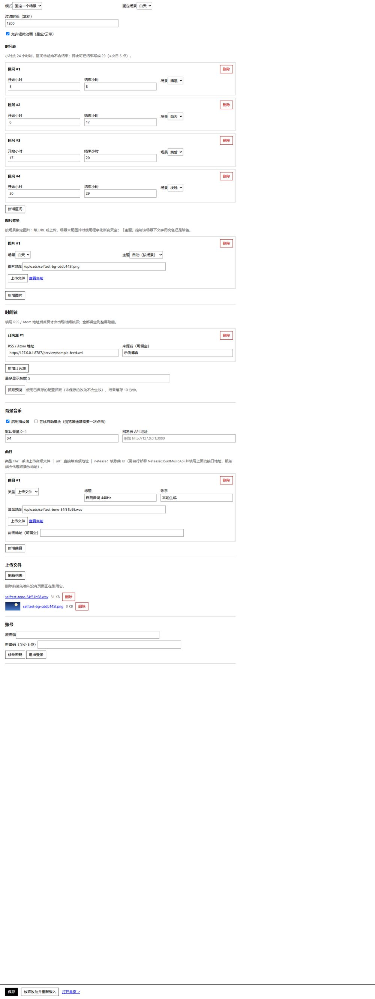

# 云间小筑 · 个人主页（首页兼导航页）+ 极简后台

[](https://www.python.org/)
[](#%E5%BF%AB%E9%80%9F%E5%BC%80%E5%A7%8B)
[](LICENSE)
[](https://github.com/sbdcf/Yunjian-Xiaozhu-Personal-Homepage/releases/tag/a0.0.2)
[](#%E5%BF%AB%E9%80%9F%E5%BC%80%E5%A7%8B)

一个可以自己改内容的个人站点：**首页兼导航页**，下滑依次展开「个人信息 → 站点导航 → 最近更新 → 底部信息」；
背景按时间自动切换，也能手动切换，还支持换成自己的图片；
配一个只用 Python 标准库写的**零依赖后台**，用来改文案、传图片、配 RSS 时间轴和背景音乐。

整个项目没有构建步骤、没有 npm、没有 CDN 外链、不联网也能跑。



## 前排提示
本项目完全本人通过WishCoding完成，一定包含大量各种各样的问题亟待解决，但本人技术有限，创此仓库以记录本人学习过程

## 目录

- [前排提示](#前排提示)
- [这是什么](#这是什么)
- [功能特性](#功能特性)
- [效果预览](#效果预览)
- [快速开始](#快速开始)
- [后台使用](#后台使用)
- [配置说明](#配置说明)
- [目录结构](#目录结构)
- [HTTP 接口](#http-接口)
- [部署](#部署)
- [安全须知](#安全须知)
- [常见问题](#常见问题)
- [开发与自测](#开发与自测)
- [设计文档](#设计文档)
- [许可证](#许可证)

## 这是什么

给「个人主页 + 博客入口」这种形态的站点准备的一套首页方案，外加一个够用就好的后台。

- **首页**：静态 HTML/CSS/JS，四屏分屏滚动，视觉极简，文字密度被刻意压到很低。
- **后台**：`server.py` 单文件，标准库实现。同时兼任站点托管、配置读写、文件上传、RSS 抓取代理和音乐地址代理。
- **可分离**：不想用后台也没关系，删掉 `server.py` 就是一套纯静态站（图片背景与音乐直链仍可用，上传/时间轴/网易云不可用）。

## 功能特性

| | 说明 |
| --- | --- |
| 分屏滚动（3 或 4 屏） | 滚轮一次一屏、键盘 `↑↓/PgUp/PgDn/Space/Home/End`、触屏原生吸附；右侧指示点数量随屏数变化 |
| 时间感知背景 | 清晨/白天/黄昏/夜晚四套 Canvas 程序化场景，按本地时间自动切换；切换是数值插值不是硬换图 |
| 手动切换背景 | 底部胶囊：自动 / 清晨 / 白天 / 黄昏 / 夜晚，纯图标 |
| 自定义图片背景 | 按场景替换为图片，支持填 URL 或直接上传；可指定该场景用亮色还是暗色文字 |
| RSS 时间轴 | 服务端抓 RSS/Atom 生成「最近更新」屏；**一个源都没填时整屏隐藏** |
| 背景音乐 | 上传音频 / 音频直链 / 网易云歌曲 ID 三种来源混编播放列表，播放暂停、上下曲、音量记忆 |
| 自适应主题 | 白天场景自动切亮色主题（深字浅玻璃），其余场景暗色，色板随场景一起过渡 |
| 该有的降级 | 无 JS → 变普通长页；无后端 → 用本地默认配置；`prefers-reduced-motion` → 取消动画与滚轮劫持 |
| 该有的可访问性 | 语义标签、图标按钮带 `aria-label`、`:focus-visible` 描边、指示点带 `aria-current` |

## 效果预览

默认首屏（白天场景 · 自动模式）：


配置了 RSS 之后多出「最近更新」一屏，左下角是音乐播放器：



把某个场景换成自己的图片，并选择与之匹配的文字主题：



四套背景 × 各屏的样子：



窄屏（390×844，真实视口）：



后台（纯表单，无装饰）：



<details>
<summary>展开看后台下半部分（时间轴 / 音乐 / 上传文件 / 账号）</summary>



</details>

> 截图里用的是演示内容（`你的名字`）。换成自己的内容之后，把 `docs/img/` 下对应的图重新截一遍即可。

## 快速开始

需要 **Python 3.8+**（在 3.12 上验证过），**不需要 `pip install` 任何东西**。

```bash
git clone https://github.com/<你的用户名>/<仓库名>.git
cd <仓库名>

python server.py            # 默认 http://127.0.0.1:8787
```

首次启动会生成后台密码并打印在控制台：

```
  已生成后台密码： xxxxxxxxxxxx
  登录地址： http://127.0.0.1:8787/admin
  站点地址： http://127.0.0.1:8787/
```

- 站点：<http://127.0.0.1:8787/>
- 后台：<http://127.0.0.1:8787/admin>

常用参数：

```bash
python server.py --port 9000        # 换端口
python server.py --host 0.0.0.0     # 对外暴露（先读「安全须知」）
python server.py --reset-password   # 忘记密码时交互式重置（不回显、不进命令历史）
python server.py --secure-cookie    # 反代没传 X-Forwarded-Proto 时强制 Secure Cookie
python server.py --allow-local-netease  # 允许网易云 API 指向本机（默认禁止，防 SSRF）
```

### 只想当纯静态站用

把目录丢到任意静态托管即可（`index.html` 会读 `assets/js/config.js` 作为内容）。
此时可用：首页、背景、图片背景（填 URL）、音乐直链。
不可用：图片上传、RSS 时间轴抓取、网易云代理 —— 这三件事必须有服务端。

## 后台使用

后台就一个页面，左侧锚点跳转，底部固定「保存」，保存后刷新首页生效。

| 区块 | 能改什么 |
| --- | --- |
| 站点与个人信息 | 站名、姓名、头像字母、身份、一句话、状态、头像（URL 或上传） |
| 社交链接 | 增删改，图标可选 |
| 导航 | 磁贴的增删改，名称 / 副标题 / 链接 / 图标 |
| 底部信息 | 版权、ICP 备案号与跳转、公安备案、次级链接 |
| 背景 | 自动或固定场景、时间表（小时区间 → 场景）、过渡时长、动画开关、每个场景的图片背景 |
| 时间轴 | RSS / Atom 地址列表、条数上限、一键「抓取预览」 |
| 音乐 | 启用开关、自动播放、默认音量、网易云 API 地址、曲目列表 |
| 上传文件 | 已上传文件列表，可预览 / 打开 / 删除 |
| 账号 | 修改密码、退出登录 |

几个约定：

- **留空即不显示**。ICP、公安备案、版权、一句话、状态、副标题、次级链接都是如此，页面上不会出现占位文字。
- 时间轴：**一个源都不填，这一屏和对应的指示点一起消失**。
- 图片背景：未配图的场景继续用程序化渐变天空；配了图的场景优先用图片，切换时交叉淡入。图片很暗或很亮时，用「主题」强制文字颜色。
- 音乐：网易云类型需要你自己部署一份 [NeteaseCloudMusicApi](https://github.com/Binaryify/NeteaseCloudMusicApi)，把地址（如 `http://127.0.0.1:3000`）填进「网易云 API 地址」。播放时浏览器请求 `/api/music/stream?i=N`，由服务端解析真实地址后 302 跳转。服务端默认只允许公网地址（防 SSRF），指向本机/内网时需在启动参数里加 `--allow-local-netease`。
- 浏览器不允许无交互自动播放，所以「尝试自动播放」会先试一次，被拦下就等第一次点击或按键再开始。

## 配置说明

配置分两层，改内容优先用后台：

| 文件 | 作用 |
| --- | --- |
| `site.default.json` | 默认值（开箱内容）。改这里等于改「新装默认」 |
| `site.json` | 后台实际保存的差异，与默认值深合并后生效；首启动自动创建。**这是你的站点内容，建议一起提交进仓库**，换机器或重新部署才不会丢 |
| `assets/js/config.js` | 离线默认配置：没有后端时页面用它；另外承载 `behavior`（滚轮阈值/锁定）等行为参数 |
| `admin.json` | 后台密码哈希（PBKDF2-SHA256）与会话密钥，首次运行生成，仅当前用户可读（Linux 600 / Windows 用 icacls 收紧），不可通过 HTTP 读取（**已在 .gitignore 中忽略**） |

想改视觉与背景算法，看这两个地方：

| 想改什么 | 在哪 |
| --- | --- |
| 四套场景的配色、日月位置、星尘、云带 | `assets/js/background.js` 顶部的 `SCENES` |
| 亮色/暗色主题色板、圆角、版心留白 | `assets/css/main.css` 顶部的 `:root` 与 `html[data-theme="light"]` |
| 滚轮灵敏度、翻屏锁定 | `assets/js/config.js` 的 `behavior` |

## 目录结构

```
index.html                 首页（分屏骨架 + SVG 图标精灵；首帧脚本外链）
admin.html                 后台页面
server.py                  后台服务（静态托管 / 配置 / 上传 / RSS / 音乐代理）
site.default.json          默认内容
assets/css/main.css        首页样式
assets/css/admin.css       后台样式
assets/js/config.js        离线默认配置
assets/js/first-frame.js   首帧定场景（外链，满足 CSP 禁止内联脚本）
assets/js/background.js    背景引擎（场景插值 / 时间调度 / 图片背景）
assets/js/music.js         背景音乐播放器
assets/js/app.js           首页运行时（取配置 / 渲染 / 分屏滚动）
assets/js/admin.js         后台逻辑
docs/DESIGN.md             设计说明与集成指南（原 README，含设计约束与集成说明）
docs/img/                  README 用图
preview/                   本地自测工具与截图（可整目录删除，截图不入库）
  ├ _api_test.py               接口自测：登录 / 上传 / RSS / Range / 越权 一次跑完
  ├ _mobile.html               用 iframe 造真实 390px 视口，复核窄屏
  ├ _login.html                本机自测登录（?p=密码），用于截图已登录后台
  └ sample-feed.xml            联调时间轴用的示例 RSS
uploads/                   上传的图片与音频（后台写入；默认一起提交，体积大时可改为忽略）
site.json                  你的站点内容（建议提交，别丢）
admin.json                 后台密码哈希与会话密钥（已忽略，绝不提交）
audit.log                  审计日志（登录/改密/改配置/上传；已忽略，不可通过 HTTP 读取）
```

## HTTP 接口

除 `/api/site`（公开投影）与 `/api/timeline`（读取缓存）外都需要登录 Cookie。

| 方法 | 路径 | 说明 |
| --- | --- | --- |
| GET | `/api/site` | 首页所需配置的公开投影（**不含** `timeline.feeds`、`music.neteaseApiBase`） |
| GET | `/api/site?full=1` | 完整配置（后台用，需登录） |
| PUT | `/api/site` | 保存配置（需登录；未知顶层键与原型污染键会被丢弃） |
| POST | `/api/login` · `/api/logout` · `/api/password` | 登录 / 退出（吊销全部旧会话）/ 改密码（至少 12 位） |
| POST | `/api/upload` | 上传（JSON + base64；图片与音频白名单 + 魔数校验，单文件 ≤ 32 MB） |
| GET | `/api/uploads` · DELETE `/api/upload?name=` | 列出 / 删除上传文件（需登录） |
| GET | `/api/timeline[?refresh=1]` | 抓取并返回时间轴条目（缓存 10 分钟；`refresh=1` 需登录） |
| GET | `/api/netease/song?id=` | 查询歌曲信息（需登录） |
| GET | `/api/music/stream?i=N` | 解析曲目播放地址并 302（目标地址做协议与 CRLF 校验） |

## 部署

推荐：服务只监听本机，前面挂 Nginx 做 HTTPS。

```nginx
server {
    listen 443 ssl http2;
    server_name example.com;
    ssl_certificate     /etc/letsencrypt/live/example.com/fullchain.pem;
    ssl_certificate_key /etc/letsencrypt/live/example.com/privkey.pem;

    client_max_body_size 32m;          # 与后端上传上限保持一致

    # 反代再兜一层基础安全头（应用自己也会发；CSP 以应用下发的为准）
    add_header X-Content-Type-Options nosniff always;
    add_header X-Frame-Options DENY always;
    add_header Referrer-Policy no-referrer always;
    add_header Strict-Transport-Security "max-age=31536000; includeSubDomains" always;

    location / {
        # 建议另在 http{} 里配 limit_req_zone 后对登录接口限速
        proxy_pass http://127.0.0.1:8787;
        proxy_set_header Host              $host;
        proxy_set_header X-Real-IP         $remote_addr;
        proxy_set_header X-Forwarded-For   $proxy_add_x_forwarded_for;
        proxy_set_header X-Forwarded-Proto $scheme;
        proxy_read_timeout 30s;
    }
}
```

systemd 常驻：

```ini
[Unit]
Description=Personal homepage with tiny admin
After=network.target

[Service]
WorkingDirectory=/srv/homepage
ExecStart=/usr/bin/python3 /srv/homepage/server.py --host 127.0.0.1 --port 8787
Restart=always
User=www-data
UMask=0077
NoNewPrivileges=true
PrivateTmp=true
ProtectSystem=strict
ProtectHome=true
ReadWritePaths=/srv/homepage

[Install]
WantedBy=multi-user.target
```

## 安全须知

- 默认只监听 `127.0.0.1`，这是刻意的。要用 `--host 0.0.0.0` 对外，先执行 `--reset-password` 设一个强密码，并放在 HTTPS 反代之后（反代没传 `X-Forwarded-Proto` 时加 `--secure-cookie`）。
- 密码用 **PBKDF2-SHA256（20 万次迭代）** 存 `admin.json`；旧版本的单轮 SHA256 记录在首次登录成功后自动升级。新密码至少 12 位；同一 IP 10 分钟内失败 5 次即返回 429。
- 登录态是 HMAC 签名、24 小时有效的 HttpOnly + `SameSite=Strict` Cookie；HTTPS 下自动改用 `__Host-` 前缀并加 `Secure`。改密码与退出登录都会立即吊销所有旧会话。
- 全站下发 CSP（`script-src 'self'`）、`X-Content-Type-Options`、`X-Frame-Options: DENY`、`frame-ancestors 'none'`、`Referrer-Policy` 等安全头；因此首页脚本全部是外链文件（含 `assets/js/first-frame.js`），不要再往 HTML 里写内联 `<script>`。
- 静态托管是**目录白名单**：只有 `index.html`、`admin.html`、`assets/`、`uploads/`、`docs/img/` 可访问；`server.py`、`site.json`、`make_speech_docx.py`、`checks.json`、`*.log`、`*.tmp` 与任何点文件一律 404。
- 上传按扩展名白名单（图片/音频，**不接受 `.svg`**）并校验文件魔数，重命名后落盘；上传目录的响应额外带沙箱 CSP。
- 服务端抓取 RSS / 网易云地址前会做 SSRF 校验：只允许公网 http(s)，且每一跳重定向都重新校验；网易云 API 指向本机需显式加 `--allow-local-netease`。
- 后台依赖同源 `SameSite=Strict` Cookie 防 CSRF；公网部署仍建议在反代再加一层访问控制。
- 审计日志写在 `audit.log`（登录成功/失败、改密、改配置、上传/删除），不含密码；该文件已不可通过 HTTP 读取，并已加入 `.gitignore`。
- `admin.json` 含密码哈希与会话密钥，**不要提交**（`.gitignore` 已忽略）；`site.json` 只是站点内容，可以放心提交。
- 部署后建议备份 `site.json` 与 `uploads/`，两者就是站点的全部内容。

## 常见问题

**Q：时间轴那一屏没出现？**
A：要么没填订阅源，要么抓取失败。去后台「时间轴」点「抓取预览」，报错会显示在下面（常见原因：地址不是 RSS、站点墙了国外 IP、证书问题）。

**Q：网易云歌曲点了播放没反应？**
A：三件事：① 有没有部署 NeteaseCloudMusicApi 并填地址；② 这首歌是否受版权/登录限制（播放器会自动跳到下一首）；③ 在后台点「查询歌曲信息」确认能取到地址。

**Q：为什么不自动播放？**
A：浏览器策略，必须有用户交互。开启自动播放后，页面会在你第一次点击或按键时开始。

**Q：忘了后台密码？**
A：`python server.py --reset-password`（交互输入两遍，至少 12 位；自动化场景可设 `HP_ADMIN_PASSWORD` 环境变量）。

**Q：能只要静态部分吗？**
A：能。删掉 `server.py`、`admin.html`、`assets/js/admin.js`、`assets/css/admin.css` 即可，首页会退回读 `assets/js/config.js`。

**Q：为什么只做 3~4 屏？**
A：这是设计约束：屏数越少，每屏越干净。时间轴屏按需出现，正好是 3 屏与 4 屏两种形态。

## 开发与自测

改完之后可以启动服务，用几条 curl 验证关键行为（接口自测脚本随 `preview/` 目录移除，不再附带）：

```bash
python server.py --reset-password                 # 一个终端（交互输入密码）
curl -i http://127.0.0.1:8787/api/site            # 公开投影：不含 feeds / neteaseApiBase
curl -i -c cookie.txt -X POST http://127.0.0.1:8787/api/login \
  -H 'Content-Type: application/json' -d '{"password":"你的密码"}'
curl -i -b cookie.txt http://127.0.0.1:8787/api/site?full=1
curl -i -b cookie.txt "http://127.0.0.1:8787/api/timeline?refresh=1"
```

重点看：安全响应头是否齐全、未登录时 `full=1` / `refresh=1` 是否 401、登录 Cookie 是否带 `HttpOnly` 与 `SameSite=Strict`。

自动化/无交互环境不要用命令行传密码，改为：

```bash
HP_ADMIN_PASSWORD='你的密码' python server.py --reset-password
```

首页支持几个联调用的 URL 参数：

| 参数 | 作用 |
| --- | --- |
| `?scene=dawn\|day\|dusk\|night\|auto` | 直接落到某个背景场景（不做过渡） |
| `?page=0..3` | 直接落到某一屏 |
| `?diag=1` | 在页面上打印关键盒模型数值，排查布局 |

窄屏复核：`preview/_mobile.html` 用 iframe 造出真实 390px 视口（有些无头浏览器会把窗口宽度钳到 492px，直接截窄屏会失真）。

## 设计文档

[`docs/DESIGN.md`](docs/DESIGN.md) 是最初那份「设计说明与集成指南」，保留了完整的设计约束推导、逐条需求对照，
以及把首页接进现有站点的分步说明。要理解「为什么这样设计」，看它；要快速跑起来，看本文件。

## 许可证

[MIT](LICENSE) · © 2025 蛋吵翻
